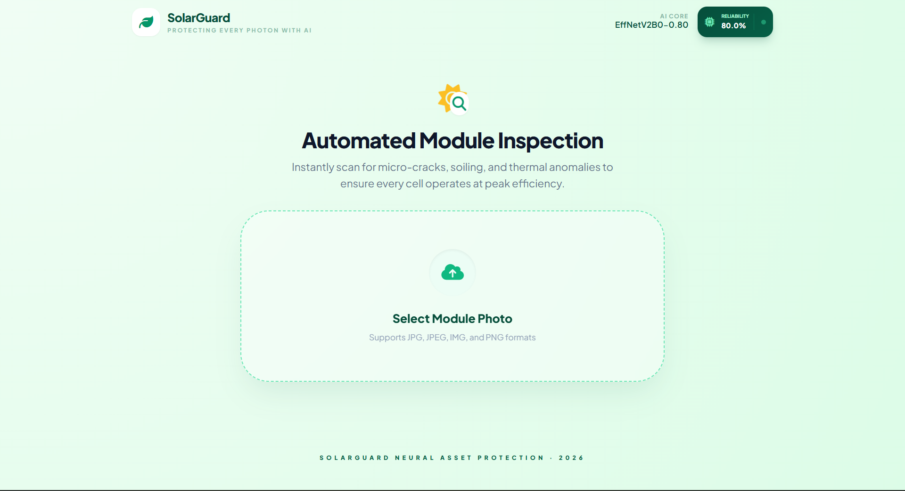
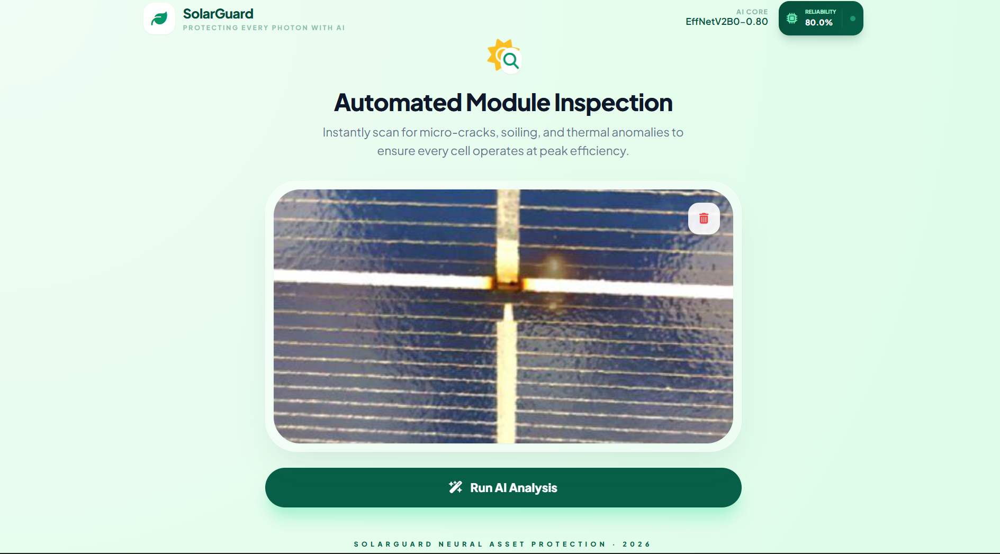
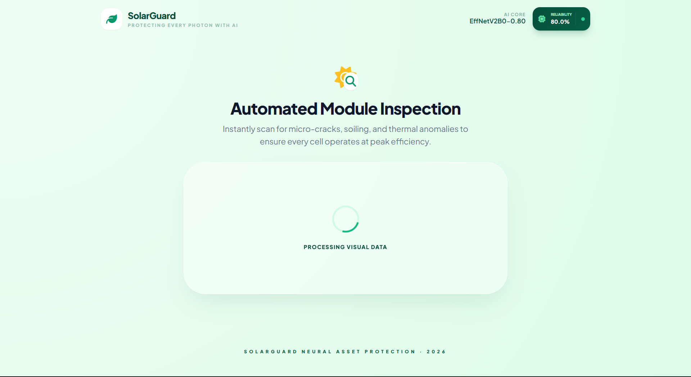
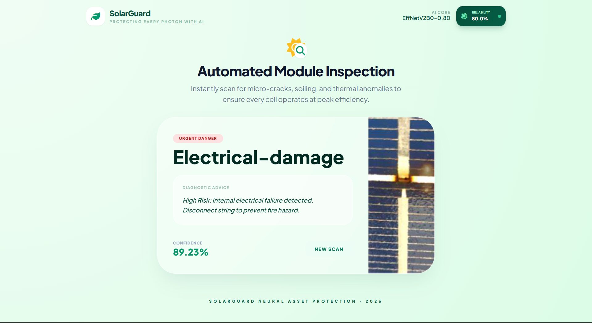
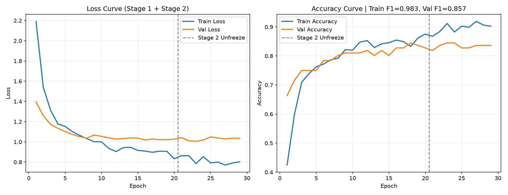
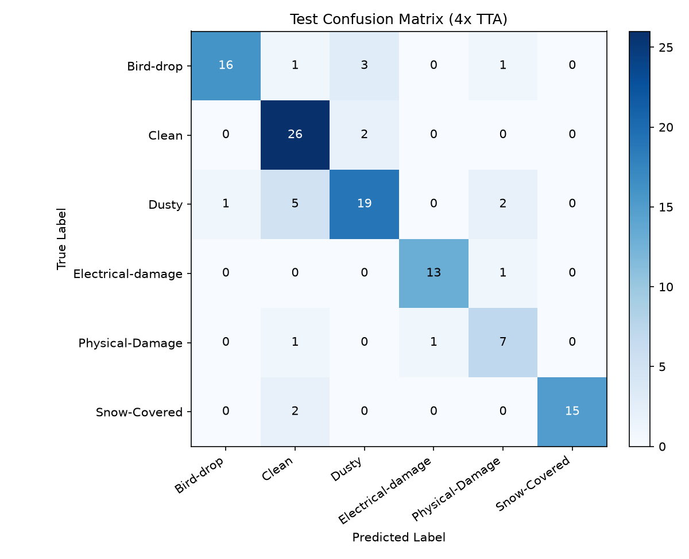

# ☀️ SolarGuard: Protecting Every Photon with AI


-FF6F00?logo=tensorflow&logoColor=white)


-82.98%25-brightgreen)


An automated deep learning web application designed to detect physical, electrical, and environmental anomalies in solar panels. Powered by a **2-stage fine-tuned `EfficientNetV2B0`** backbone quantized to **Float16 TensorFlow.js (`12.12 MB`)**, SolarGuard runs **100% client-side in the browser** — enabling instant, zero-backend, privacy-preserving diagnostics across 6 solar panel health categories.

---

## 🚀 Key Features

- **100% Client-Side AI Inference:** Powered by `@tensorflow/tfjs` (`GraphModel`, Float16 quantized to `12.12 MB`) — images never leave the user's browser, with zero server inference cost.
- **Fine-Tuned EfficientNetV2B0:** Optimized via 15-trial Adaptive HPO + 2-stage transfer learning (`82.76%` held-out test accuracy, `82.98%` 4x TTA Macro-F1).
- **6-Class Diagnostics:** Classifies `Bird-drop`, `Clean`, `Dusty`, `Electrical-damage`, `Physical-Damage`, and `Snow-Covered` panels.
- **Actionable Field Recommendations:** Displays urgency levels, confidence scores, and maintenance guidance tailored to each detected anomaly.
- **Zero-Backend Deployment:** Ready for 1-click deployment on **Vercel** or via multi-stage **Docker** (`node:22-alpine` standalone build).

---

## 🖼️ Application Walkthrough

| **Step 1: Home Page** | **Step 2: Module Upload** |
|:---:|:---:|
|  |  |
| **Home Page** <br> Clean glassmorphism dashboard serving as the central hub for automated solar panel inspection. | **Module Upload** <br> Drag-and-drop or file picker with built-in image type and size validation. |

| **Step 3: AI Analysis** | **Step 4: Diagnostic Result** |
|:---:|:---:|
|  |  |
| **AI Analysis** <br> On-device `EfficientNetV2B0` inference via TensorFlow.js on `224x224` RGB inputs. | **Diagnostic Result** <br> Displays predicted defect class, urgency badge, confidence percentage, and maintenance advice. |

---

## 📈 Dataset Hygiene & Stratified Splits

To prevent train/validation/test data leakage, all `871` raw images were MD5-hashed prior to splitting:
- **Exact same-class duplicates removed:** `87`
- **Cross-class label conflicts excluded:** `2` hashes (`8` files)
- **Clean unique dataset:** **`776` images**, stratified `70% / 15% / 15%` into Train (`544`), Validation (`116`), and untouched Held-Out Test (`116`)

| Category | Raw | Clean Unique | Train (70%) | Val (15%) | Test (15%) |
|:---|:---:|:---:|:---:|:---:|:---:|
| 🦅 **Bird-drop** | 191 | 141 | 99 | 21 | 21 |
| ✨ **Clean** | 193 | 186 | 130 | 28 | 28 |
| 🌫️ **Dusty** | 192 | 182 | 128 | 27 | 27 |
| ⚡ **Electrical-damage** | 103 | 91 | 63 | 14 | 14 |
| 🔨 **Physical-Damage** | 69 | 63 | 45 | 9 | 9 |
| ❄️ **Snow-Covered** | 123 | 113 | 79 | 17 | 17 |
| **Total** | **871** | **776** | **544** | **116** | **116** |

---

## 📊 Model Training, HPO & Performance

The model was trained using a **15-trial Adaptive HPO** search (9 Explore + 6 Exploit) optimizing a generalization-penalized Validation Macro-F1 objective, followed by **2-stage fine-tuning** (20 epochs frozen head warmup + Stage 2 unfreezing the top `45` backbone layers / `36` non-BN layers with all `BatchNormalization` layers kept frozen).

### Training Curves & Test Confusion Matrix

| **Stage 1 + Stage 2 Learning Curves** | **Held-Out Test Confusion Matrix (4x TTA)** |
|:---:|:---:|
|  |  |

### Held-Out Test Set Results (`116` Unseen Images, 4x TTA)

| Category | Precision | Recall | F1-Score | Support | Status |
|:---|:---:|:---:|:---:|:---:|:---|
| 🦅 **Bird-drop** | 0.9412 | 0.7619 | 0.8421 | 21 | Maintenance Needed |
| ✨ **Clean** | 0.7429 | 0.9286 | 0.8254 | 28 | Optimal Condition |
| 🌫️ **Dusty** | 0.7917 | 0.7037 | 0.7451 | 27 | Minor Cleaning |
| ⚡ **Electrical-damage** | 0.9286 | 0.9286 | 0.9286 | 14 | **Urgent Danger** |
| 🔨 **Physical-Damage** | 0.6364 | 0.7778 | 0.7000 | 9 | Attention Required |
| ❄️ **Snow-Covered** | 1.0000 | 0.8824 | 0.9375 | 17 | Obstructed |
| **Accuracy** | — | — | **0.8276** | **116** | — |
| **Macro Avg** | **0.8401** | **0.8305** | **0.8298** | **116** | — |
| **Weighted Avg** | — | — | **0.8289** | **116** | — |

> Full 15-trial HPO table, selected hyperparameters, 1-crop vs. 4x TTA breakdown, and fit diagnostics are documented in [model/TRAINING.md](model/TRAINING.md).

### Web Quantization (Float16)

| Artifact | Format | Size |
|:---|:---|:---:|
| Fine-Tuned Training Checkpoint | Keras HDF5 (`FP32`) | `24.39 MB` |
| Web Production Model (`public/model/`) | TensorFlow.js `GraphModel` (`Float16`, 3 shards) | **`12.12 MB`** (`50.3%` smaller) |

---

## 📂 Project Structure

```text
SolarGuard/
├── app/
│   ├── globals.css                 # Tailwind CSS + custom glassmorphism styles
│   ├── layout.js                   # Root layout, metadata & Font Awesome icons
│   └── page.js                     # Home page entry
├── components/
│   └── SolarGuardApp.jsx           # Interactive upload, preview, loading & result UI
├── lib/
│   └── tfModel.js                  # TensorFlow.js loader, validation & inference logic
├── public/
│   └── model/
│       ├── model.json              # Float16 TF.js GraphModel manifest
│       └── group1-shard*of3.bin    # Quantized model weights (12.12 MB total)
├── model/
│   ├── TRAINING.md                 # Full 15-trial HPO & evaluation report
│   └── finetuned/                  # Training curves, confusion matrix & JSON report
├── static/
│   └── images/                     # Application walkthrough screenshots
├── tests/
│   └── tfModel.test.mjs            # Unit & Float16 GraphModel inference tests
├── Dockerfile                      # 3-stage Node 22-alpine Next.js standalone build
├── docker-compose.yml              # Docker Compose setup with Node healthcheck
├── next.config.mjs                 # Standalone output & image configuration
├── package.json                    # Dependencies & scripts
├── LICENSE                         # MIT License
└── README.md
```

---

## 💻 Tech Stack

- **Web Framework:** Next.js 15 (App Router), React 19, JavaScript
- **Styling:** Tailwind CSS v3, Plus Jakarta Sans, Font Awesome 6
- **Client-Side ML Inference:** TensorFlow.js (`@tensorflow/tfjs` Float16 GraphModel)
- **Model Training & HPO:** TensorFlow / Keras (`EfficientNetV2B0`), Adaptive 2-Stage HPO
- **Testing:** Node.js built-in test runner (`node --test`)
- **Deployment:** Vercel (Zero-Config), Docker & Docker Compose (`node:22-alpine`)

---

## 🔧 Local Development & Testing

### Prerequisites
- [Node.js](https://nodejs.org/) 20+ (tested on Node 22 / 26)

### Quick Start
1. **Clone the repository:**
   ```bash
   git clone https://github.com/alokprasad573/Solar-Panel-Anomaly-Detection-using-Deep-Learning.git
   cd Solar-Panel-Anomaly-Detection-using-Deep-Learning
   ```
2. **Install dependencies:**
   ```bash
   npm install
   ```
3. **Run the development server:**
   ```bash
   npm run dev
   ```
   Open `http://localhost:3000` in your browser.

### Tests & Production Build
```bash
# Run unit tests + Float16 TF.js GraphModel inference test
npm test

# Build optimized production bundle
npm run build
npm run start
```

---

## ☁️ Deployment

### Option A — Vercel (Recommended)
1. Import the GitHub repository into [Vercel](https://vercel.com/).
2. Keep the default Next.js build settings (`npm run build`).
3. Deploy — `public/model/` is served directly as static assets with zero serverless memory or timeout issues.

### Option B — Docker & Docker Compose
The project ships with a 3-stage **Node.js 22 Alpine** standalone Dockerfile (`deps` → `builder` → non-root `runner`) and a built-in HTTP healthcheck.

```bash
# Build & start container
docker compose up --build

# Run in background
docker compose up -d --build

# View logs / stop
docker compose logs -f
docker compose down
```

Open `http://localhost:3000` once the container is healthy.

## 📄 License

This project is licensed under the **MIT License** — see the [LICENSE](LICENSE) file for details.

---

*Developed for smart grid optimization and predictive maintenance.*  
**Made with ❤️ by Alok Prasad**
