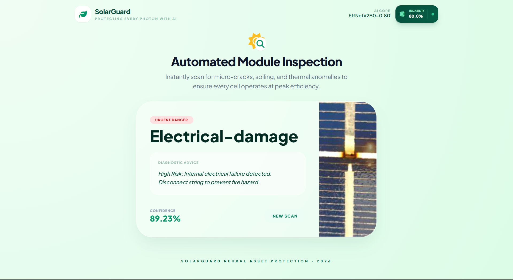

# ☀️ SolarGuard: Protecting Every Photon with AI.


An automated deep learning solution designed to identify physical and electrical anomalies in solar panels. Using an EfficientNetV2B0 backbone, this system categorizes module health into 6 distinct classes, enabling predictive maintenance for sustainable energy infrastructure.

## 🚀 Key Features
- **EfficientNetV2B0 Architecture:** Optimized for high accuracy with low computational overhead.
- **6-Class Diagnostics:** Identifies Bird-drop, Clean, Dusty, Electrical-damage, Physical-Damage, and Snow-Covered panels.
- **Real-Time Interface:** Interactive dashboard for RGB module analysis.
- **Automated Recommendations:** Provides field-level maintenance advice based on detection results.

## 🖼️ Application Walkthrough

| **Step 1: Home Page** | **Step 2: Module Upload** |
|:---:|:---:|
|  |  |
| **Home Page** <br> A sleek, intuitive dashboard serving as the central hub for automated solar panel inspection. | **Module Upload** <br> A seamless drag-and-drop interface for uploading high-resolution solar module imagery for analysis. |

| **Step 3: AI Analysis** | **Step 4: Diagnostic Result** |
|:---:|:---:|
|  |  |
| **AI Analysis** <br> Advanced feature extraction powered by EfficientNetV2B0 to rapidly detect and classify surface anomalies. | **Diagnostic Result** <br> Detailed diagnostic breakdown providing predicted defect classes, confidence scores, and actionable maintenance tasks. |

---

## 📈 Dataset Distribution

The model is trained on a dataset containing the following class distribution:
- **Bird-drop:** 191 images
- **Clean:** 194 images
- **Dusty:** 192 images
- **Electrical-damage:** 103 images
- **Physical-Damage:** 69 images
- **Snow-Covered:** 123 images

---

## 📊 Model Performance
| Category | Precision | Recall | F1-Score | Support | Status |
|:---|:---:|:---:|:---:|:---:|:---|
| 🦅 **Bird-drop** | 0.86 | 0.78 | 0.82 | 40 | Maintenance Needed |
| ✨ **Clean** | 0.64 | 0.91 | 0.75 | 33 | Optimal Condition |
| 🌫️ **Dusty** | 0.86 | 0.79 | 0.83 | 48 | Minor Cleaning |
| ⚡ **Electrical-damage** | 0.73 | 0.85 | 0.79 | 13 | **Critical Risk** |
| 🔨 **Physical-Damage** | 0.86 | 0.57 | 0.69 | 21 | Attention Required |
| ❄️ **Snow-Covered** | 0.94 | 0.89 | 0.92 | 19 | Obstructed |
| | | | | |
| **Accuracy** | | | **0.80** | **174** | |


## 📂 Project Structure
```text
SolarGuard-Protecting-Every-Photon-with-AI/
├── Model/                      # Trained model weights
│   └── effnetV2B00.80.h5       # EfficientNetV2B0 (80% accuracy)
├── NoteBooks/                  # Jupyter notebooks
│   ├── EfficientNetV2B0.ipynb  # Model training workflow
│   ├── SolarPanelDefectClassification.ipynb
│   └── Test.ipynb              # Batch testing & evaluation
├── static/                     # Front-end resources
│   ├── images/                 # Web UI screenshots
│   ├── script.js               # UI logic & API communication
│   └── style.css               # Custom glassmorphism styling
├── templates/
│   └── index.html              # Dashboard view
├── main.py                     # Flask inference API & routing
├── FixedDense.py               # Custom Keras layer for model compatibility
├── requirements.txt            # Project dependencies
├── .gitignore                  # Git ignore rules
└── Readme.md
```

## 💻 Tech Stack
- **Languages:** Python, HTML/CSS, JavaScript
- **Deep Learning:** TensorFlow, Keras (EfficientNetV2B0 transfer learning)
- **Computer Vision:** OpenCV, scikit-image
- **Data Science:** NumPy, scikit-learn, Matplotlib
- **Web Framework:** Flask, Waitress (production server)
- **Frontend:** Tailwind CSS (CDN), Vanilla JS

## 🔧 Installation & Usage
1. **Clone the repository:**
   ```bash
   git clone https://github.com/yourusername/solar-defect-classification.git
   ```
2. **Setup environment:**
   ```bash
   pip install -r requirements.txt
   ```
3. **Run the application:**
   ```bash
   python main.py
   ```
   Open `http://localhost:5000` in your browser.

---
*Developed for smart grid optimization and predictive maintenance.*
