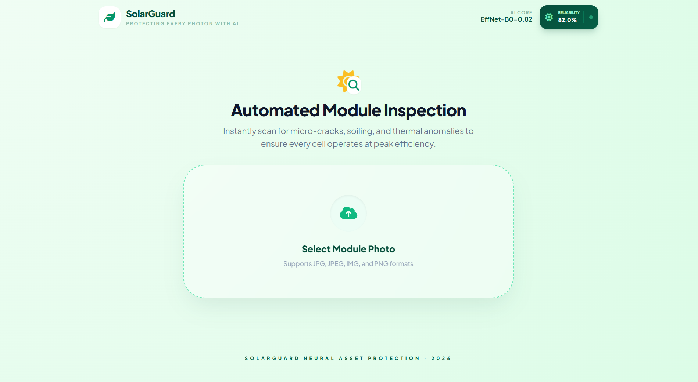

# ☀️ SolarGuard: Protecting Every Photon with AI.


An automated deep learning solution designed to identify physical and electrical anomalies in solar panels. Using an EfficientNetB0 backbone, this system categorizes module health into 6 distinct classes, enabling predictive maintenance for sustainable energy infrastructure.

## 🚀 Key Features
- **EfficientNetB0 Architecture:** Optimized for high accuracy with low computational overhead.
- **6-Class Diagnostics:** Identifies Bird-drop, Clean, Dusty, Electrical-damage, Physical-Damage, and Snow-Covered panels.
- **Real-Time Interface:** Interactive dashboard for RGB module analysis.
- **Automated Recommendations:** Provides field-level maintenance advice based on detection results.

## 🖼️ Application Walkthrough

| **Step 1: Home Page** | **Step 2: Module Upload** |
|:---:|:---:|
|  |  |
| **Home Page** <br> Centralized control center for rapid module inspection and real-time telemetry monitoring. | **Module Upload** <br> Optimized drag-and-drop interface supporting high-resolution RGB imagery. |

| **Step 3: AI Analysis** | **Step 4: Diagnostic Result** |
|:---:|:---:|
|  |  |
| **AI Analysis** <br> Deep feature extraction using EfficientNetB0 to identify microscopic structural defects. | **Diagnostic Result** <br> Comprehensive impact reports featuring actionable maintenance protocols and confidence scoring. |

---


## 📊 Model Performance
| Category | Precision | Recall | F1-Score | Status |
|:---|:---:|:---:|:---:|:---|
| 🦅 **Bird-drop** | 0.87 | 0.82 | 0.85 | Maintenance Needed |
| ✨ **Clean** | 0.65 | 0.97 | 0.78 | Optimal Condition |
| 🌫️ **Dusty** | 0.87 | 0.69 | 0.77 | Minor Cleaning |
| ⚡ **Electrical-damage** | 0.81 | 1.00 | 0.90 | **Critical Risk** |
| 🔨 **Physical-Damage** | 1.00 | 0.70 | 0.82 | Attention Required |
| ❄️ **Snow-Covered** | 0.95 | 0.90 | 0.92 | Obstructed |

## 📂 Project Structure
```text
SolarPanelDefectClassification/
├── Model/                  # Trained Weights (effnet_0.82.h5)
├── NoteBooks/              # Training and Testing workflows (Jupyter)
├── static/                 # Front-end resources
│   ├── images/             # Web UI Screenshots
│   ├── script.js           # UI logic and API communication
│   └── style.css           # Custom glassmorphism styling
├── templates/              # Dashboard View (index.html)
├── main.py                 # Flask Inference API & Logic
├── FixedDense.py           # Custom Keras layer for model compatibility
├── requirements.txt        # Project dependencies
├── .gitignore              # Git ignore rules
└── README.md
```

## 💻 Tech Stack
- **Languages:** Python, HTML/CSS, JavaScript.
- **ML/DS:** TensorFlow, Keras, OpenCV, NumPy.
- **Web:** Flask, Tailwind CSS (CDN).

## 🔧 Installation & Usage
1. **Clone the repository:**
   ```bash
   git clone https://github.com/yourusername/solar-defect-classification.git
   ```
2. **Setup environment:**
   ```bash
   pip install -r requirements.txt
   ```
3. **Run the application:**
   ```bash
   python main.py
   ```
   Open `http://localhost:5000` in your browser.

---
*Developed for smart grid optimization and predictive maintenance.*
